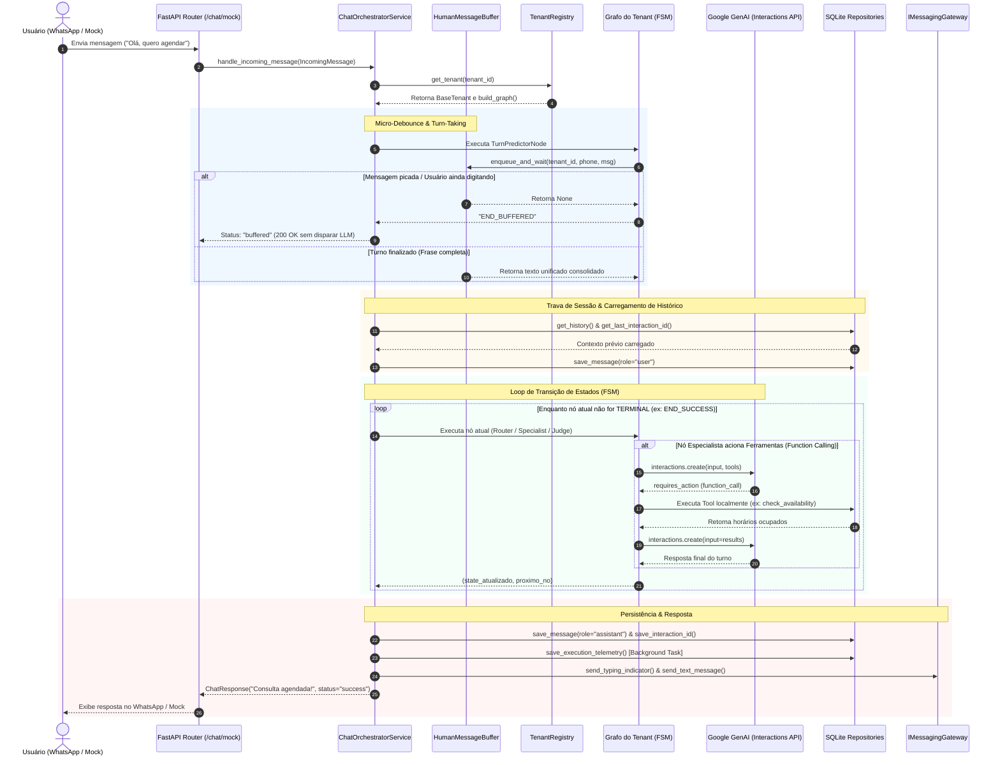

# 🤖 Assistente Virtual Multi-Tenant com GenAI & Grafos de Estados (FSM)

> Plataforma assíncrona corporativa de atendimento inteligente baseada em **Modelos de Linguagem (LLMs)**, **Máquinas de Estados Finitas (FSM)** e **Arquitetura Multi-Tenant**. Construída sobre o ecossistema do **FastAPI**, **Google GenAI Interactions API** e banco de dados **SQLite concorrente em modo WAL**.

---

## 📑 Sumário

1. [Visão Geral & Proposta de Valor](#-visão-geral--proposta-de-valor)
2. [Conceitos de Engenharia & Padrões de Projeto](#-conceitos-de-engenharia--padrões-de-projeto)
3. [O Ciclo de Vida de uma Mensagem (Passo a Passo)](#-o-ciclo-de-vida-de-uma-mensagem-passo-a-passo)
4. [Estrutura de Pastas e Módulos](#-estrutura-de-pastas-e-módulos)
5. [Estudo de Caso: Os Tenants Implementados](#-estudo-de-caso-os-tenants-implementados)
   - [Padaria Pão Quente (`padaria_01`)](#1-padaria-pão-quente-padaria_01)
   - [Clínica Odontológica Sorriso (`clinica_01`)](#2-clínica-odontológica-sorriso-clinica_01)
6. [Resiliência, Concorrência e Gestão de Custos](#-resiliência-concorrência-e-gestão-de-custos)
7. [Guia de Configuração e Instalação Local](#-guia-de-configuração-e-instalação-local)
8. [Como Criar um Novo Tenant (Passo a Passo)](#-como-criar-um-novo-tenant-passo-a-passo)
9. [Roadmap para o Piloto Comercial](#-roadmap-para-o-piloto-comercial)

---

## 💡 Visão Geral & Proposta de Valor

Diferente de chatbots tradicionais baseados em árvores estáticas de perguntas e respostas ou de simples "wrappers" que mandam todo o histórico para uma única chamada de LLM, esta aplicação foi desenhada como um **sistema multiagente orientado a grafos**.

### O que o sistema resolve?
* **Multi-Tenancy Real:** Uma única instância do servidor atende diferentes empresas de forma totalmente isolada. Cada estabelecimento possui seus próprios prompts, ferramentas, base de documentos RAG e topologia de grafo.
* **Turn-Taking Inteligente (Micro-debounce):** Clientes no WhatsApp costumam enviar mensagens picadas ("Oi", "tudo bem?", "quero agendar um horário"). O sistema agrupa essas mensagens antes de consultar a IA, economizando até **70% do consumo de tokens** e evitando respostas desconexas.
* **Execução Não-Bloqueante (9.5/10 Assíncrono):** Todas as operações de I/O (consultas HTTP, banco de dados SQLite com `aiosqlite`, SDK do Google e APIs de mapas) operam sem bloquear o *Event Loop* do Python.
* **Governança e Confiabilidade:** Possui nós de auditoria em tempo real (*LLM-as-a-Judge*) para barrar alucinações e um painel de telemetria que rastreia custos com base em uma estimativa calibrada de **3.8 caracteres por token**.

---

## 🧠 Conceitos de Engenharia & Padrões de Projeto

Para navegar com segurança pelo código, é fundamental compreender os cinco padrões arquiteturais que sustentam a aplicação:

### 1. FSM (Finite State Machine) / Orquestração por Grafos
A conversa não segue um script rígido. O atendimento é modelado como um grafo direcionado composto por nós (`IGraphNode`). Cada nó processa o contexto atual, executa uma ação (seja chamar uma IA ou rodar código Python local) e decide qual é o próximo nó de destino (ex: `roteador` $\rightarrow$ `agente_agendamento` $\rightarrow$ `juiz_avaliador` $\rightarrow$ `END_SUCCESS`).

### 2. Padrão Blackboard (Estado Compartilhado)
Representado pela classe `GraphState`. Conforme a mensagem trafega pelos nós do grafo, ela carrega consigo um objeto central ("a lousa") contendo:
* Mensagem atual e histórico da conversa.
* ID de sessão da Google Interactions API.
* Anotações internas das ferramentas chamadas (`internal_scratchpad`).
* Feedbacks de reprovação do nó auditor (`errors_feedback`).
* Métricas granulares de caracteres e tokens consumidos por cada nó.

### 3. Inversão de Controle (IoC) e Injeção de Dependências (DIP)
O projeto aplica rigorosamente o princípio da Inversão de Dependência do **SOLID**. Módulos de alto nível (como o orquestrador de chat) nunca dependem diretamente de implementações de baixo nível (como SQLite ou Evolution API). Eles dependem de interfaces abstratas (`ISessionRepository`, `IMessagingGateway`, `ILLMAgent`). O `AppContainer` é o maestro responsável por instanciar e injetar as dependências no momento da inicialização.

### 4. Concorrência Persistente em SQLite (WAL Mode)
O SQLite nativo bloqueia todo o arquivo durante qualquer operação. Para contornar isso, a camada de persistência utiliza:
* `aiosqlite` para delegar I/O a threads em segundo plano.
* **WAL (Write-Ahead Logging):** Permite leitura simultânea infinita enquanto uma escrita ocorre.
* **Conexões Persistentes:** O banco é aberto uma vez no *startup* e fechado no *shutdown*, eliminando o gargalo de abrir e fechar descritores de arquivos do sistema operacional a cada mensagem.

### 5. LLM-as-a-Judge com Circuit Breaker
Em fluxos críticos (como agendamentos médicos), a resposta proposta pela IA passa por um nó auditor antes de chegar ao cliente. Caso o modelo tente confirmar uma consulta sem antes ter verificado a disponibilidade no banco de dados, o Juiz reprova a resposta, fornece a crítica e devolve ao agente para correção. Se falhar 2 vezes seguidas, o **Circuit Breaker** é acionado, interrompendo o ciclo para evitar queima desnecessária de tokens e enviando o cliente para transbordo humano (`END_HANDOFF`).

---

## 🔄 O Ciclo de Vida de uma Mensagem (Passo a Passo)

Abaixo está o fluxo completo percorrido por uma mensagem, desde a chegada via HTTP/WhatsApp até o retorno validado:



---

## 📂 Estrutura de Pastas e Módulos

```text
projeto_automacao_wpp/
│
├── app/
│   ├── api/                            # Camada de Entrada HTTP (Controladores REST)
│   │   └── dashboard_router.py         # Endpoints do Dashboard de telemetria e topologia
│   │
│   ├── core/                           # Configuração Global e Fundações
│   │   ├── config.py                   # Pydantic Settings (.env, portas, chaves)
│   │   ├── container.py                # Contêiner de Inversão de Controle (IoC / DI)
│   │   └── logger.py                   # Logger assíncrono com ContextVars (Tenant & Phone)
│   │
│   ├── domain/                         # O Coração do Software (Regras e Contratos Puros)
│   │   ├── interfaces.py               # Contratos abstratos (Ports) de repositórios, nós e gateways
│   │   └── models.py                   # GraphState (Blackboard), DTOs e telemetria de tokens
│   │
│   ├── infrastructure/                 # Adaptadores Concretos (Banco, LLM, Mensageria)
│   │   ├── database/                   # Implementações aiosqlite persistentes (WAL)
│   │   │   ├── aiosqlite_clinica_repo.py
│   │   │   ├── aiosqlite_dashboard_repo.py
│   │   │   └── aiosqlite_session_repo.py
│   │   ├── llm/                        # Clientes do Google GenAI SDK
│   │   │   ├── gemini_agent.py         # Agente conversacional com Function Calling concorrente
│   │   │   ├── gemini_predictor.py     # Classificador leve de fim de turno
│   │   │   └── judge_logger.py         # Auditor assíncrono de alucinação em background
│   │   ├── messaging/                  # Gateways de envio de mensagens
│   │   │   ├── mock_gateway.py         # Gateway simulado para testes web locais
│   │   │   └── whatsapp_gateway.py     # Adaptador Evolution API v2 para WhatsApp real
│   │   └── nodes/                      # Nós reutilizáveis da Máquina de Estados (FSM)
│   │       ├── judge_node.py           # Nó LLM-as-a-Judge com Circuit Breaker
│   │       ├── router_node.py          # Nó classificador e direcionador de intenções
│   │       ├── specialist_node.py      # Nó do Agente com injeção de consciência temporal
│   │       └── turn_predictor_node.py  # Nó de debounce e agregação de frases
│   │
│   ├── models/                         # DTOs de Request e Response da API Web
│   │   └── chat.py                     # ChatRequest e ChatResponse (Pydantic)
│   │
│   ├── services/                       # Motores de Orquestração da Aplicação
│   │   ├── chat_orchestrator.py        # Motor de execução do Grafo de Estados (FSM Engine)
│   │   ├── dashboard_service.py        # Inspetor de topologia (Mermaid.js) e métricas
│   │   ├── message_buffer.py           # Buffer preemptivo com controle via asyncio.Future
│   │   └── rag_service.py              # Sincronizador de bases vetoriais no Google File Search
│   │
│   ├── tenants/                        # Implementações de Negócio Específicas por Empresa
│   │   ├── base.py                     # Classe base abstrata para todos os Tenants
│   │   ├── registry.py                 # Catálogo centralizado e registro de Tenants
│   │   ├── padaria/                    # Tenant: Padaria Pão Quente
│   │   │   ├── prompts.py              # Instruções de personalidade e regras
│   │   │   ├── tenant.py               # Construção do grafo linear simples
│   │   │   └── tools.py                # Geocodificação Nominatim e cálculo de frete
│   │   └── clinica/                    # Tenant: Clínica Odontológica Sorriso
│   │       ├── prompts.py              # Prompts do Roteador, Agente de Agendamento e Juiz
│   │       ├── tenant.py               # Construção do grafo multiagente complexo
│   │       └── tools.py                # Integração com banco SQLite da agenda
│   │
│   └── main.py                         # Ponto de entrada FastAPI e gerenciador de Lifespan
│
├── data/                               # Dados persistidos localmente (Ignorados pelo Git)
│   ├── app_sessions.db                 # Banco global de histórico e telemetria
│   └── tenants/                        # Documentos RAG e bancos dedicados por empresa
│       ├── clinica_01/                 # clinica.db + arquivos .pdf/.txt
│       └── padaria_01/                 # cardapio.pdf / regulamentos
│
├── dashboard_frontend/                 # Frontend estático da GUI do Dashboard
├── mock_frontend/                      # Frontend estático simulador do WhatsApp Web
├── requirements.txt                    # Dependências do ecossistema Python
└── .env.example                        # Modelo de variáveis de ambiente
```

---

## 🏢 Estudo de Caso: Os Tenants Implementados

O projeto vem com dois exemplos completos que ilustram abordagens arquiteturais distintas:

### 1. Padaria Pão Quente (`padaria_01`)
* **Padrão de Grafo:** **Linear Simples (2 Nós)**.
* **Topologia:** `preditor_turno` $\longrightarrow$ `agente_balcao` $\longrightarrow$ `END_SUCCESS`.
* **Características:**
  * Foco em resposta rápida e conversação direta.
  * Utiliza **Geocodificação Reversa** via OpenStreetMap/Nominatim com cálculo geodésico (`geopy`) para descobrir a distância exata em quilômetros da padaria até a casa do cliente, aplicando tabela progressiva de entrega.
  * Contém rate limiting interno (`1.1s`) para não violar os termos de serviço da API de mapas.

### 2. Clínica Odontológica Sorriso (`clinica_01`)
* **Padrão de Grafo:** **Multiagente Especializado com Roteamento e Feedback Loop**.
* **Topologia:**
  ```text
                  ┌───► [agente_duvidas (RAG)] ───────────────────────────────► END_SUCCESS
                  │
  [roteador] ─────┤
                  │
                  └───► [agente_agendamento] ───► [juiz_avaliador] ─┬─ (Aprovado) ──► END_SUCCESS
                                                          ▲         │
                                                          └─────────┴─ (Reprovado) [Até 2x]
                                                                    │
                                                                    └── (Falha 3x) ──► END_HANDOFF
  ```
* **Características:**
  * **Separação de Responsabilidades (SRP):** O nó de dúvidas gerais só enxerga os PDFs/RAG institucionais; ele **não** tem acesso às ferramentas de agendamento. O nó de agendamento só enxerga as ferramentas de banco de dados.
  * **Concorrência Atômica:** Registros no banco de dados utilizam a trava `UNIQUE(appointment_date, appointment_time, doctor_normalized)`, impossibilitando que dois pacientes agendem o mesmo médico no mesmo minuto.
  * **Juiz Auditor em Tempo Real:** Valida se a secretária virtual não inventou um agendamento sem antes ter recebido o "Sucesso" da ferramenta do banco de dados.

---

## 🛡️ Resiliência, Concorrência e Gestão de Custos

| Desafio Técnico | Como a Aplicação Resolve |
| :--- | :--- |
| **Rajadas de Mensagens ("Picadas")** | O `HumanMessageBuffer` utiliza uma abordagem preemptiva orientada a `asyncio.Future`. Se o cliente envia 3 mensagens em 1 segundo, as 2 primeiras são canceladas de imediato e o sistema responde apenas à última, agrupando todo o texto. |
| **Alucinações Circulares** | O `JudgeEvaluatorNode` possui um **Circuit Breaker** interno. Se a IA falhar na auditoria 2 vezes consecutivas, o turno é finalizado com uma mensagem educada de transbordo (`END_HANDOFF`), impedindo loops infinitos e consumo desenfreado de cota. |
| **Falha em Chamadas de Ferramentas** | A execução múltipla de ferramentas no `GeminiInteractionsAgent` roda com isolamento de exceções e `return_exceptions=True` no `asyncio.gather`. Uma falha em uma ferramenta externa não quebra as demais nem derruba a requisição. |
| **Transparência de Custos (FinOps)** | A classe `GraphState` acumula o total de caracteres de entrada e saída por nó. O `DashboardService` calcula a estimativa de tokens consumidos utilizando a proporção empírica da Google GenAI de **1 token $\approx$ 3.8 caracteres**, permitindo auditar o custo de cada empresa atendida. |

---

## 🚀 Guia de Configuração e Instalação Local

### Pré-requisitos
* **Python 3.10** ou superior instalado.
* Chave de API do **Google AI Studio** (obtenha gratuitamente em [aistudio.google.com](https://aistudio.google.com)).

### Passo 1: Clonar o Repositório e Criar o Ambiente Virtual

```bash
# Clone o projeto (ou extraia os arquivos)
cd projeto_automacao_wpp

# Crie o ambiente virtual
python -m venv venv

# Ative o ambiente virtual
# No Linux/macOS:
source venv/bin/activate
# No Windows (PowerShell):
.\venv\Scripts\Activate.ps1
```

### Passo 2: Instalar as Dependências

```bash
pip install --upgrade pip
pip install -r requirements.txt
```

### Passo 3: Configurar as Variáveis de Ambiente

Crie um arquivo `.env` na raiz do projeto copiando o modelo:

```bash
cp .env.example .env
```

Edite o arquivo `.env` com suas credenciais:

```ini
# Chave obrigatória do Google Gemini
GEMINI_API_KEY=AIzaSySuA_ChAvE_AqUi_Do_GoOgLe

# Modelos recomendados (Otimizados para velocidade e custo)
MODEL_NAME=gemini-3.5-flash-lite
CLASSIFIER_MODEL_NAME=gemini-3.5-flash-lite

# Ambiente e Porta
ENVIRONMENT=development
PORT=8000
ENABLE_DEBUG_LOGS=true

# Caminhos dos Bancos SQLite
SESSIONS_DB_PATH=data/app_sessions.db
CLINICA_DB_PATH=data/tenants/clinica_01/clinica.db

# Gateway de WhatsApp (Deixe vazio para usar a interface Web Mock nativa)
WHATSAPP_API_URL=
WHATSAPP_API_KEY=
```

### Passo 4: Executar o Servidor

```bash
uvicorn app.main:app --reload --port 8000
```

O servidor inicializará as conexões com o SQLite em modo WAL e iniciará a sincronização assíncrona dos documentos RAG em background.

### Passo 5: Testar a Aplicação

Abra o seu navegador de preferência:

1. **Simulador de WhatsApp (Mock Web):**  
   Acesse: [http://localhost:8000/mock](http://localhost:8000/mock)  
   *Selecione o tenant (Padaria ou Clínica), digite um número fictício e converse em tempo real.*

2. **Dashboard de Insights & Telemetria:**  
   Acesse: [http://localhost:8000/dashboard](http://localhost:8000/dashboard)  
   *Visualize a topologia interativa em Mermaid.js, os documentos RAG indexados, as ferramentas ativas e o consumo histórico de tokens.*

3. **Documentação OpenAPI / Swagger:**  
   Acesse: [http://localhost:8000/docs](http://localhost:8000/docs)

---

## 🛠️ Como Criar um Novo Tenant (Passo a Passo)

Graças ao desacoplamento arquitetural, adicionar uma nova empresa (ex: uma imobiliária chamada `imobiliaria_01`) não requer mexer em nenhuma linha do motor do orquestrador:

### 1. Criar a Pasta do Tenant
Crie a pasta `app/tenants/imobiliaria/` contendo:
* `prompts.py`: Contendo o `SYSTEM_INSTRUCTION`.
* `tools.py`: Classes com os métodos de negócio encapsulados retornando instâncias de `AppTool`.
* `tenant.py`: Classe herdando de `BaseTenant`.

### 2. Implementar a Classe `Tenant`
Exemplo de implementação em `app/tenants/imobiliaria/tenant.py`:

```python
from typing import Dict, List, Tuple
from app.domain.interfaces import AppTool, IGraphNode, ILLMAgent
from app.infrastructure.nodes import SpecialistAgentNode, TurnPredictorNode
from app.services.message_buffer import HumanMessageBuffer
from app.tenants.base import BaseTenant
from app.tenants.imobiliaria.prompts import SYSTEM_INSTRUCTION
from app.tenants.imobiliaria.tools import ImobiliariaToolService

class ImobiliariaTenant(BaseTenant):
    def __init__(
        self,
        tool_service: ImobiliariaToolService,
        llm_agent: ILLMAgent,
        message_buffer: HumanMessageBuffer,
    ) -> None:
        super().__init__()
        self._tool_service = tool_service
        self._llm_agent = llm_agent
        self._message_buffer = message_buffer

    @property
    def tenant_id(self) -> str:
        return "imobiliaria_01"

    @property
    def name(self) -> str:
        return "Imobiliária Prime"

    @property
    def system_instruction(self) -> str:
        return SYSTEM_INSTRUCTION

    def get_tools(self) -> List[AppTool]:
        return self._tool_service.get_tools()

    def build_graph(self) -> Tuple[Dict[str, IGraphNode], str]:
        nodes: Dict[str, IGraphNode] = {
            "preditor_turno": TurnPredictorNode(
                message_buffer=self._message_buffer,
                next_node="agente_corretor",
            ),
            "agente_corretor": SpecialistAgentNode(
                node_name="CorretorVirtualNode",
                llm_agent=self._llm_agent,
                system_instruction=self.system_instruction,
                tools=self.get_tools(),
                knowledge_store_id=self.file_search_store_id,
                next_node="END_SUCCESS",
            ),
        }
        return nodes, "preditor_turno"
```

### 3. Registrar no `AppContainer`
Em `app/core/container.py`, instancie o serviço de ferramentas e adicione uma linha de registro:

```python
self.imobiliaria_tools = ImobiliariaToolService(...)
self.tenant_registry.register_tenant(
    ImobiliariaTenant(
        tool_service=self.imobiliaria_tools,
        llm_agent=self.llm_agent,
        message_buffer=self.message_buffer,
    )
)
```

Automaticamente, o novo tenant passará a ser listado no seletor do Frontend Mock, no Dashboard de Telemetria e nos endpoints REST sem qualquer outra modificação.

---

## 🎯 Roadmap para o Piloto Comercial

Para transformar este protótipo de alta fidelidade em um produto em produção com clientes reais, o foco prioritário deve ser:

- [x] **Arquitetura Assíncrona e Resiliente:** Eliminação de gargalos no Event Loop e conexão persistente no SQLite.
- [x] **Nós com Circuit Breaker:** Blindagem contra loops infinitos de auditoria de qualidade.
- [ ] Integração com o API do Whatsapp Business
- [ ] Plataforma para os tenants adicionarem ferramentas, documentos e informações
- [ ] Engenharia de prompt
- [ ] **Handover Humano em Tempo Real:** Adicionar um gatilho de pausa (`human_takeover: bool`) para que atendentes humanos assumam conversas pelo WhatsApp quando o nó `END_HANDOFF` for disparado.
- [ ] **Empacotamento com Docker & Docker Compose:** Criar um ambiente autocontido reunindo a API FastAPI, a Evolution API v2 e um servidor Redis para o gateway de mensageria.
- [ ] **Suporte a Áudio (Whisper / Gemini Multimodal):** Adicionar um pré-processador no endpoint de webhook para transcrever mensagens de voz antes da ingestão pelo grafo.
- [ ] **Políticas de Retenção LGPD:** Implementar rotinas automáticas de expiração e anonimização de dados pessoais sensíveis nas tabelas de mensagens e telemetria.
- [ ] Hospedar no AWS
